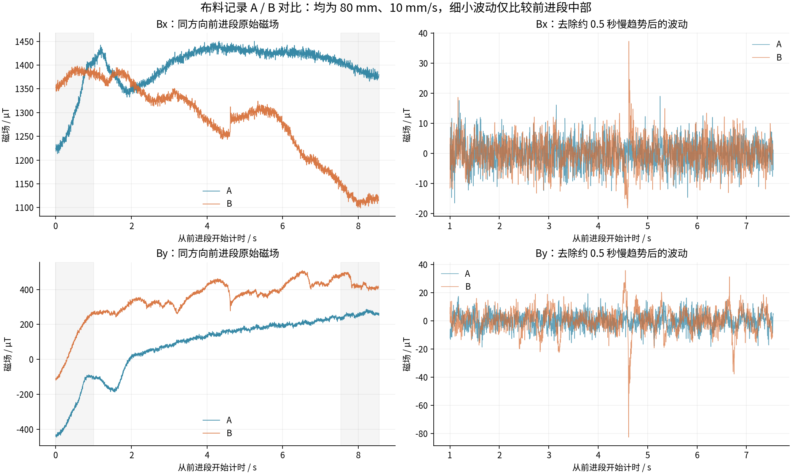
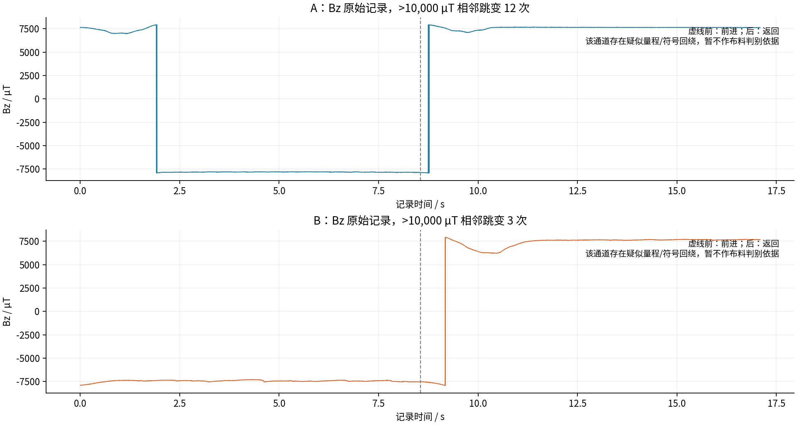

# A / B 两次布料记录比较

分析日期：2026-11-12。A 为 18:51:52，B 为 18:52:57。原始数据保持不变。

## 结论

这两次记录的 Bx、By 整体曲线和慢趋势差异明显，具有进一步区分布料的线索。但每个标签只有一次完整扫描，无法评估稳定识别两种布料的准确率，也不能排除接触高度、压入量和安装状态等影响。去除慢趋势后，Bx 细小波动接近，By 的 B 记录较大，但仍需独立重复确认。

## 比较方法

两次元数据的运动设置相同：X 前进 80 mm 后返回，速度 10 mm/s，加速度 20 mm/s²，Z 保持 0。均标记真实设备和正常完成，共用同一基线。文件未记录布料实体名称及接触预压；按用户要求使用 A、B 标签。

仅用同方向前进 step_001 比较，剔除首尾各 1 秒并应用原 sample_valid 标记。两份中部均有 2174 行。细小波动指标在分析副本中先按设备时间插值到均匀网格，再减去约 0.5 秒窗口二阶 Savitzky–Golay 慢趋势并计算 RMS。这是描述性滤波，没有改变 CSV、删改原始值或拟合分类器。

| 指标 | A | B |
|---|---:|---:|
| 全程记录行数 | 5688 | 5687 |
| 总时长 / s | 17.093 | 17.094 |
| 平均采样频率 / Hz | 332.71 | 332.63 |
| 原质量标记无效行数 | 7 | 2 |
| 前进中部 Bx 均值 / µT | 1410.76 | 1293.70 |
| 前进中部 By 均值 / µT | 110.05 | 371.76 |
| 前进中部 Bx 标准差 / µT | 27.06 | 61.24 |
| 前进中部 By 标准差 / µT | 112.42 | 66.70 |
| Bx 去慢趋势 RMS / µT | 4.32 | 4.93 |
| By 去慢趋势 RMS / µT | 5.35 | 8.44 |
| Bz 相邻跳变超过 10,000 µT 的次数 | 12 | 3 |

## Bz 数据质量

两份数据均在约 +7930 与 -7930 µT 附近出现正负跳变，跳变量约 15,850 µT。这与量程/符号回绕相符，但没有当前采集板的固件配置，尚不能确认原因。A 在前进约 1.91 秒出现持续翻转，B 的前进段主要保持负值。不能把其巨大均值差或标准差当作布料证据，也不应直接用该通道训练。原孤立尖峰规则没有标记全部持续翻转样本，因此 sample_valid=1 不等于已经排除该问题。

本文没有解包修正 Bz，没有把疑似回绕值还原成假定的真实磁场。若现用器件是 MLX90393，其输出范围随增益/分辨率而变，应核对实际配置和原始寄存器解码；见[厂商数据手册](https://media.melexis.com/-/media/files/documents/datasheets/mlx90393-datasheet-melexis.pdf)。器件型号和设置不能仅凭同目录旧固件推定。

## 后续验证

先核对 Bz 通道。固定传感器高度、预压、扫描方向及速度，交替对 A/B 多次独立重复扫描，检查同类差异是否小于异类差异。训练/验证应按完整扫描分组；同一条扫描切出的窗口不是新的独立布料试次，不能随机分窗后把结果作为稳定布料识别率。

## 图与来源

A：[sensor.csv](/home/serein/classify-cloth/xz-control/data/experiments_linux/20261112_185152_549605/sensor.csv)

B：[sensor.csv](/home/serein/classify-cloth/xz-control/data/experiments_linux/20261112_185257_470986/sensor.csv)
