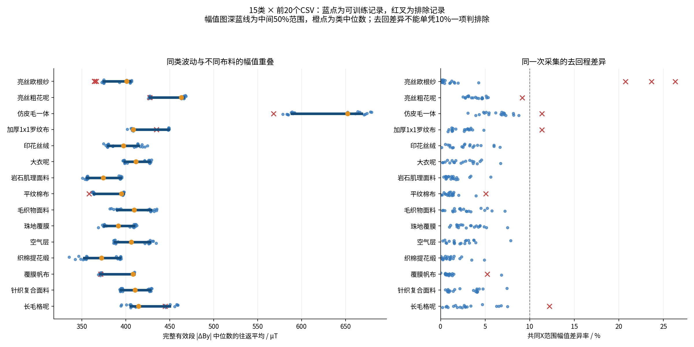
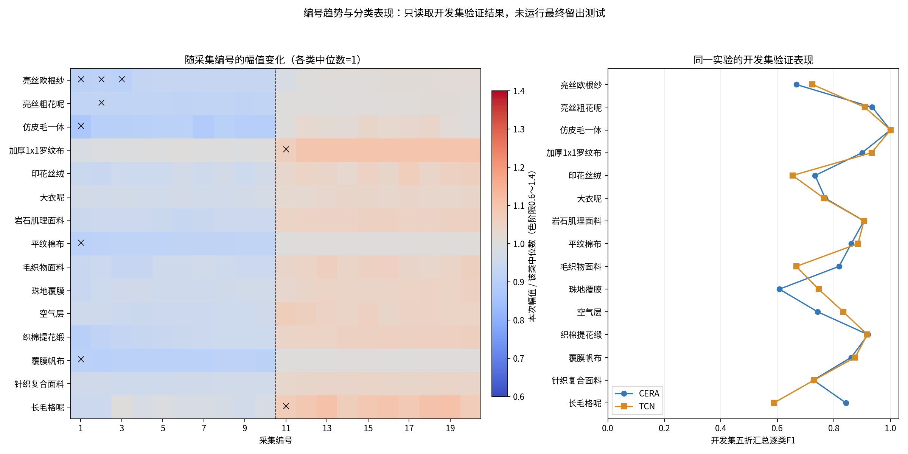

# 前20组布料采集数据差异分析

分析对象：当前窗口导入的15类布料，每类001—020，共300个CSV。已有审查规则保留291个可训练CSV，9个排除，其中历史7个、自动四项规则新增2个；11个建议复核记录保持正常权重。
原CSV和metadata的SHA256与冻结审查记录逐一核对通过。没有修改源数据、训练设置、审查规则或已有实验。没有新建训练，也没有计算最终留出测试成绩。描述性统计覆盖所选300个CSV，因此包括实验预留测试部分的输入数据；模型成绩只引用已有开发集验证预测。若据此调整预处理、模型或采集方案，最终跨批次结论应另用新独立采集数据验证。
主信号为|ΔBy|，按现有流程使用去程45—142mm、回程16—114mm、333Hz。每个CSV的代表幅值定义为“去程训练段中位数与回程训练段中位数的平均”。这个标量只用于描述，不等于模型的完整输入。

## 结论

数据既包含布料之间的可分类差异，也包含同一布料跨采集批次的变化。当前最明显的系统性变化是：全部15类的011—020组幅值都高于001—010组。以早段为分母计算的增加幅度约7.1%—13.7%；采用两段均值作分母的对称差异率约6.9%—12.8%。两种百分比定义不同，不能混用。
同一编号段内部，各类代表幅值的变异系数中位数分别为0.47%和0.53%。这说明合并20组后的波动很大一部分来自编号段之间的偏移，而不是每次采集都随机大幅变化。
日期按Asia/Shanghai转换；001—010主要来自11月13—14日，011—020来自11月16日。采集日期与编号段关联；不能仅凭这些记录认定变化来自布料、触角安装高度、接触载荷或温漂中的哪一项。

## 类内变化与类别重叠

| 布料 | 可训练/20 | 前10组中位数 μT | 后10组中位数 μT | 相对前10组增加 | 全部有效CSV幅值范围 μT | 合并后变异系数 |
|---|---:|---:|---:|---:|---:|---:|
| 亮丝欧根纱 | 17 | 374.70 | 404.85 | 8.0% | 372.83–406.50 | 3.8% |
| 亮丝粗花呢 | 19 | 427.35 | 465.45 | 8.9% | 425.55–468.38 | 4.4% |
| 仿皮毛一体 | 19 | 588.08 | 668.55 | 13.7% | 578.66–679.65 | 6.7% |
| 加厚1x1罗纹布 | 19 | 407.32 | 448.80 | 10.2% | 401.77–449.25 | 5.1% |
| 印花丝绒 | 20 | 379.65 | 415.16 | 9.4% | 374.74–424.73 | 4.7% |
| 大衣呢 | 20 | 398.49 | 426.83 | 7.1% | 396.71–429.15 | 3.5% |
| 岩石肌理面料 | 20 | 355.88 | 394.20 | 10.8% | 350.77–395.33 | 5.3% |
| 平纹棉布 | 19 | 363.30 | 397.28 | 9.4% | 360.90–398.02 | 4.6% |
| 毛织物面料 | 20 | 390.08 | 428.98 | 10.0% | 381.90–435.15 | 5.2% |
| 珠地覆膜 | 20 | 375.52 | 409.48 | 9.0% | 368.62–412.35 | 4.5% |
| 空气层 | 20 | 387.60 | 427.35 | 10.3% | 386.02–434.70 | 5.1% |
| 织棉提花缎 | 20 | 352.16 | 393.34 | 11.7% | 335.40–394.72 | 6.1% |
| 覆膜帆布 | 19 | 371.10 | 409.43 | 10.3% | 368.85–409.95 | 5.0% |
| 针织复合面料 | 20 | 394.42 | 427.72 | 8.4% | 393.15–429.75 | 4.1% |
| 长毛格呢 | 19 | 405.67 | 450.45 | 11.0% | 394.35–459.30 | 5.9% |

大衣呢和针织复合面料的代表幅值类中位数分别约411.53和410.66μT，差约0.86μT；两类各自有效记录的范围约396.71—429.15和393.15—429.75μT，存在明显重叠。因此只用一个均值或中位数不足以区分全部类别。仿皮毛一体幅值明显较高，是较容易区分的例子，但不能代表其余14类也都容易。
幅值标量总变异中约88.7%来自类别之间，但该数受仿皮毛一体这一明显高幅值类别影响；去掉该类后约54.2%。这些都是全样本描述性统计，不能解释为识别准确率。

## 去回程差异与审查

对291个可训练CSV，未标准化|ΔBy|的共同X范围去回幅值差异率：中位数1.95%，90分位5.24%，最大8.77%。当前主要系统性幅值偏移来自编号段之间。
取绝对值消除符号差异，不保证方向相反时的幅值、摩擦形变和局部波形完全相同。当前同时覆盖两方向，并按CSV/会话同组划分，能让模型学习方向带来的变化，同时避免去回程跨训练/验证的泄漏。
排除的9个CSV仍保留用于诊断显示：

- 亮丝欧根纱_001：用户确认本实验排除，建议复采
- 亮丝欧根纱_002：用户确认本实验排除，建议复采
- 亮丝欧根纱_003：用户确认本实验排除，建议复采
- 亮丝粗花呢_002：用户确认本实验排除，建议复采
- 仿皮毛一体_001：用户确认本实验排除，建议复采
- 加厚1x1罗纹布_011：四项大幅去回不一致条件全部满足
- 平纹棉布_001：用户确认本实验排除，建议复采
- 覆膜帆布_001：用户确认本实验排除，建议复采
- 长毛格呢_011：四项大幅去回不一致条件全部满足

前后批次有偏移不等于文件错误，不能据此自动删除整批数据；现有异常判据要求去回四项条件同时满足，或有已确认的历史排除记录。

## 与已有模型的开发集验证结果对应

引用实验：/home/serein/classify-cloth/布料分类训练脚本/outputs/models/CLOTH4_20261118_043041_a4aed4
五折均值±折间标准差如下；这是Macro-F1，不是准确率，不是最终留出测试结果。

| 模型 | 验证Macro-F1均值 | 折间标准差 |
|---|---:|---:|
| GRU | 0.3823 | 0.0490 |
| TCN | 0.8069 | 0.0668 |
| CERA | 0.8186 | 0.0336 |

TCN/CERA的结果说明完整序列中包含可用的分类信息。但目前无法仅据性能确定模型具体使用了哪些物理特征；GRU较低也不能单独归因于采集质量，模型结构、读出和训练设置同样有影响。
把所选配置的开发集各折验证预测汇总，每个开发集单程恰好一次，共464条单程。CERA中较多见的双向混淆对如下，数量是错分单程数，不是独立CSV数：

- 亮丝欧根纱 ↔ 珠地覆膜：8条（4 + 4）。
- 大衣呢 ↔ 毛织物面料：7条（4 + 3）。
- 空气层 ↔ 针织复合面料：7条（2 + 5）。
- 珠地覆膜 ↔ 空气层：5条（4 + 1）。
- 亮丝欧根纱 ↔ 印花丝绒：4条（1 + 3）。

CERA开发集逐类F1：仿皮毛一体1.000、亮丝粗花呢0.935；珠地覆膜0.607、亮丝欧根纱0.667。易混类别需要结合局部波形信息识别，幅值重叠与错分现象相符，但这不是单一因果证明。
当前每一折的训练区和验证区都混有001—010与011—020两段记录。虽然CSV/会话分组避免了同次往返泄漏，当前结果仍不能代替“完全新采集日期/新安装条件”的验证。

## 对训练的实际影响与下一步

1. 类间稳定差异是分类依据；同类采集条件变化会扩展类别分布，可能压低验证分数，也可能在覆盖充分时提高模型对这些条件的适应能力。
2. 目前优先增加独立批次覆盖，而非仅在同一次摆放下重复更多次。可为各类均衡增加不同日期、重新铺布、重新安装触角等独立采集，并记录这些条件。
3. 测试跨批次能力时应另定预先锁定的批次/日期划分，使用未用于模型选择的新独立批次。不要在现有最终测试结果上反复调参。此项是实验建议，没有更改当前脚本或划分。
4. 继续使用训练区拟合的标准化；不要为了让批次曲线看起来一致，就逐个CSV强制归一化或修改基线，这可能同时消除有效布料差异。如研究额外归一化，应另立对照并只用开发集比较。
5. 当前Z记录是软件零点坐标，无法证明不同日期的机械高度、触角压入深度一致。需要固定可追溯机械参考，并记录压入量/接触载荷、触角安装、布料铺设、传感器温度等条件，才能进一步判断偏移来源。

完整逐类数字见“各布料差异统计.csv”，逐记录指标与来源信息见“分析结果.json”。